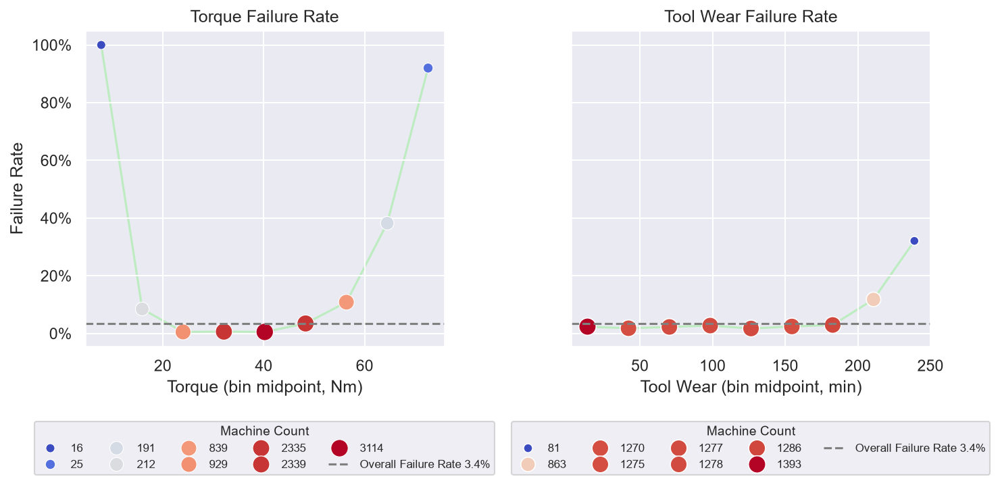

# Predictive Maintenance Analysis
Using Python (pandas) and SQL, I analyzed a synthetic dataset of 10,000 machines to discover which operating conditions are most associated with failure.

## Key Findings
Torque shows a U-shape (about 0.6% of machines failed at 20 to 39 Nm, against 83% at 65 Nm and above). Tool wear stays low until about 200 minutes and then rises (14% at 200 to 229 minutes and 31% at 230 and above). The extreme bands are small groups (65 machines in the top torque band and 45 in the top tool wear band), so the rates are less precise. 



The correlations look weak (0.19 for torque and 0.11 for tool wear) even though the effects are strong, because they only measure straight-line relationships.

[Read the full summary](summary.md)

## Dataset
This analysis uses the [AI4I 2020 Predictive Maintenance Dataset](https://archive.ics.uci.edu/dataset/601/ai4i) from the UCI Machine Learning Repository (S. Matzka, 2020), licensed [CC BY 4.0](https://creativecommons.org/licenses/by/4.0/). It is a synthetic dataset modeled on real industrial data, downloaded via Kaggle. 

The data is in `predictive_maintenance.csv`: 10,000 rows, one per machine, with the operating readings, a failure flag (`Target`) and a failure type (`Failure Type`).

## What's in the repo
* `pd_analysis.py`: checks the data for missing values and duplicates, summarizes it, and creates the charts.
* `sql_analysis.py`: the key results from `pd_analysis.py` re-run in SQLite, plus the CTE, window functions and quality checks.
* charts: `correlation_heatmap.png`, `failure_rate_scatterplot.png`, `failure_type_count.png`, `wear_and_torque_failure.png`.
* `summary.md`: the full write-up.
* `predictive_maintenance.csv`: the dataset (10,000 rows).

## How to run it
1. Install the libraries: 
   
   ```bash
   pip install pandas numpy matplotlib seaborn
   ```

2. Put `predictive_maintenance.csv` in the same folder as the scripts.
3. Run the analysis:
   
   ```bash
   python pd_analysis.py
   python sql_analysis.py
   ```